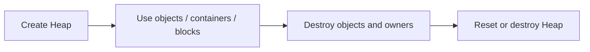

# Independent Heap

[Index](../README.md) · **English** · [简体中文](heap.zh-CN.md)

Examples: [Quick Start](../../README.md#quick-start).

## Scope and lifetime

`Heap heap;` (or `Memory::heap()`) creates an independent allocation group with the CMake-selected backend. All backends support the common APIs and owns, reset, collect. The constructor selects per-instance statistics and defaults to Disabled. Heap controls are available on `Heap`, while common operations also work through `Memory&`.

## Operations

| Method | Purpose |
| --- | --- |
| `reset()` | Release all blocks and restart Basic counters; failure preserves allocations |
| `collect()` | Reclaim idle memory while preserving live allocations |
| `owns(ptr)` | Check whether a live allocation belongs to this Heap |
| `statistics()` | Five-field request-counter value |

## Usage rules

- Destroy objects, containers, owners and remaining weak_ptr control blocks before reset/destruction; bulk release does not run object destructors
- Allocation/free may run concurrently; collect, reset and Memory destruction require exclusive access; synchronize object access separately
- `owns(nullptr)` returns false; other pointers must be live allocation starts from the same backend, not arbitrary or dangling addresses
- Collection need not immediately reduce memory usage or drain every thread cache

[Stack](stack.md) · [Statistics](statistics.md) · [Lifetime and threads](../compatibility.md)

Heap owns its backend state: a native mimalloc heap, a dedicated jemalloc arena, or a Default allocation group. Physical page isolation is not guaranteed.
