# Performance report

[UniMemory](../README.md) · **English** · [简体中文](performance.zh-CN.md)

## Overview

Compare results within each workload. Each figure records its measured source and aggregation method; detailed tables include variation across independent process trials.

| Legend | Meaning |
| --- | --- |
| Native | Direct allocator calls |
| UniMemory | Statistics off |
| API + stats | Statistics on |

## 1 · Throughput

**Allocation/free pairs per second as thread count increases; higher is better.** A 64-byte cross-thread release workload.

### Linux x64

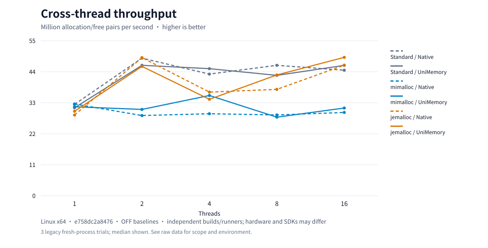

### Windows x64

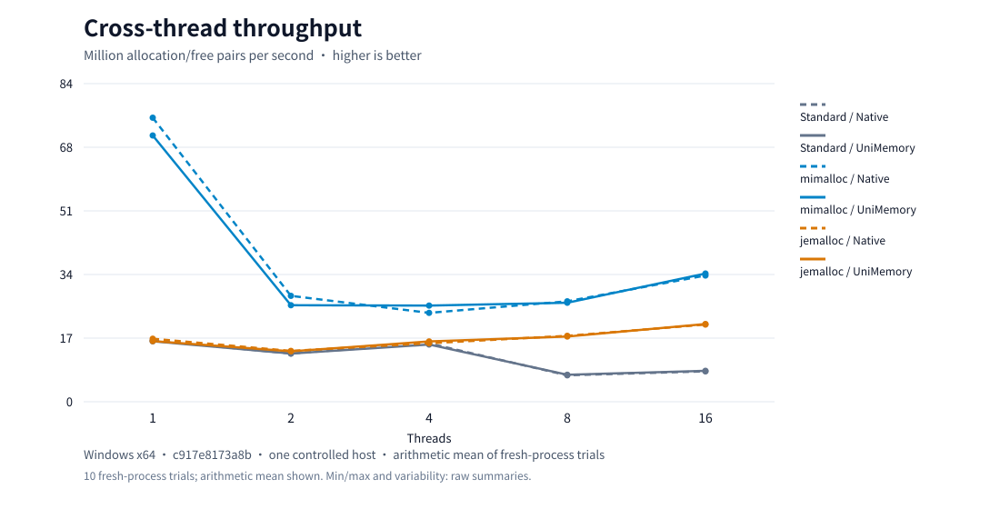

### macOS

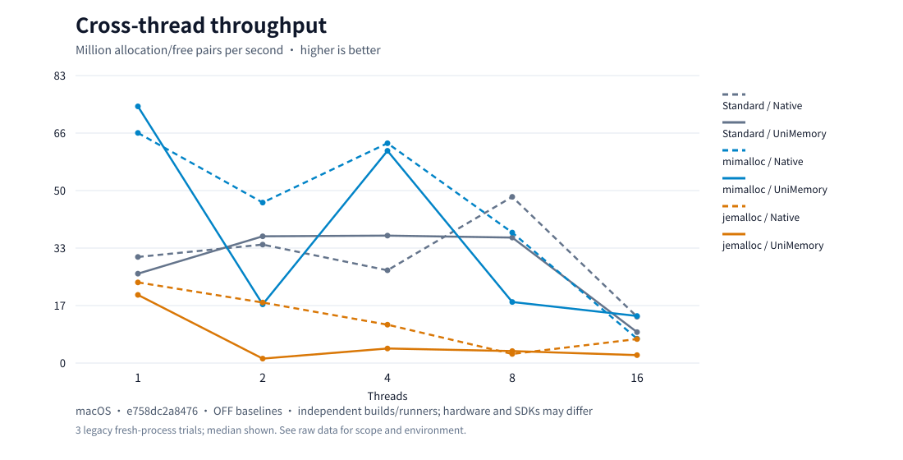

## 2 · Peak memory

**Resident memory under the same workload; lower is better.** Includes thread stacks, process and allocator state.

### Linux x64

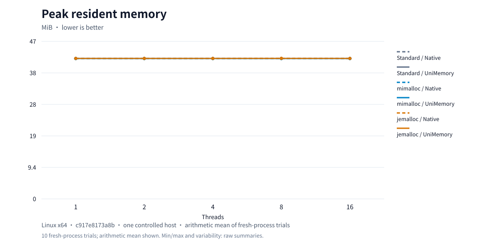

### Windows x64

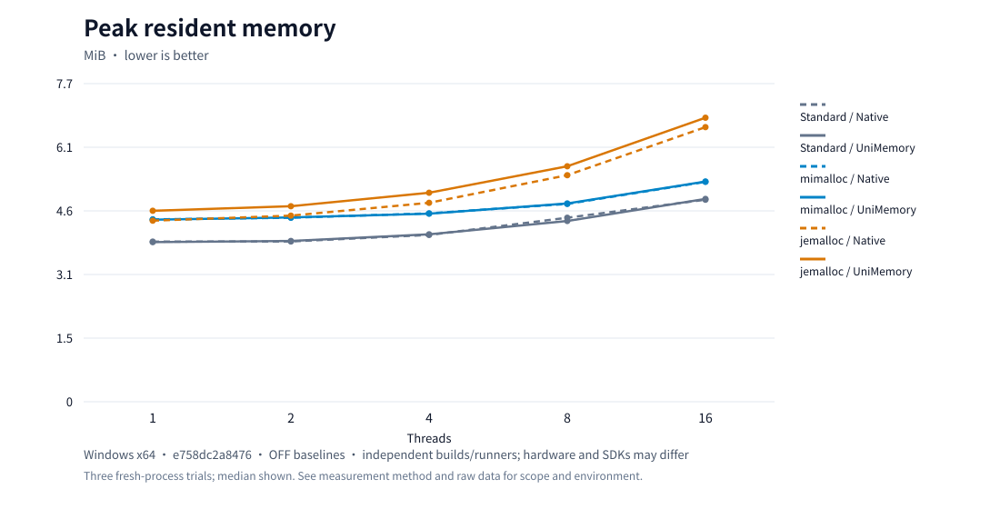

### macOS

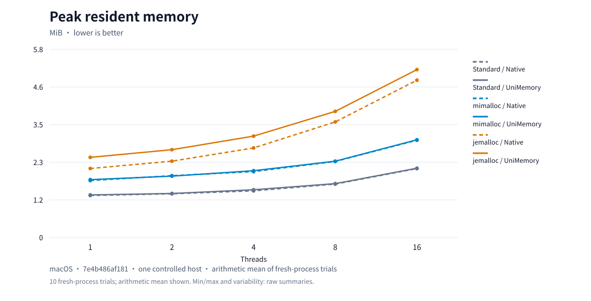

## 3 · Tail latency

**Slow allocation requests at each size; lower is better.** P99 means 99% of samples are at or below this latency; clock overhead is included.

### Linux x64

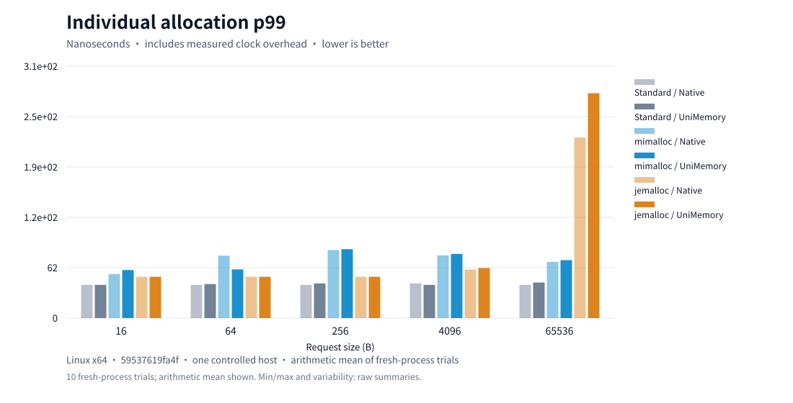

### Windows x64

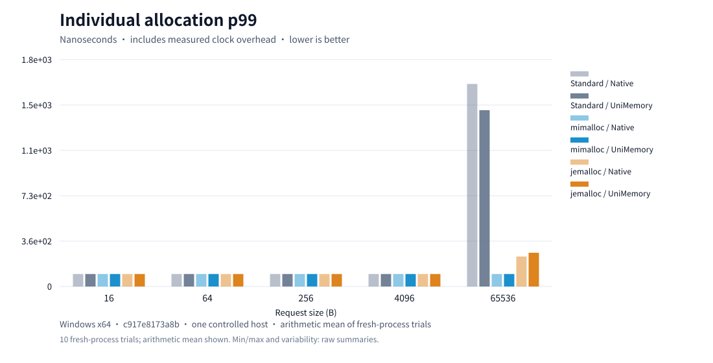

### macOS

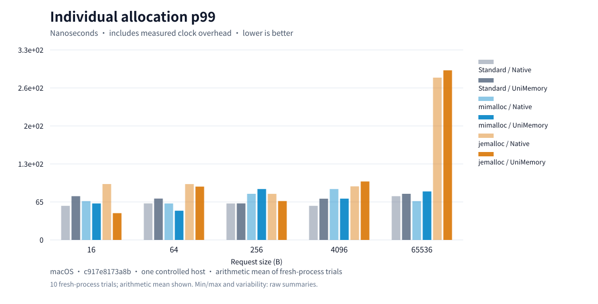

## 4 · Statistics cost

**Allocation latency with statistics off or on; lower is better.** Patterned columns enable statistics. These are separate runs, not a controlled difference measurement.

### Linux x64

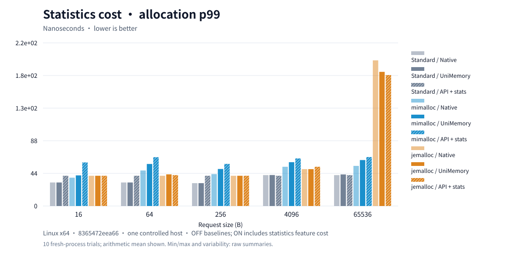

### Windows x64

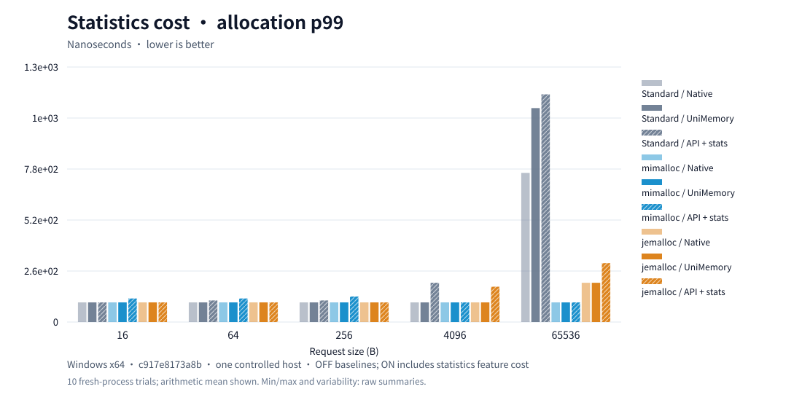

### macOS

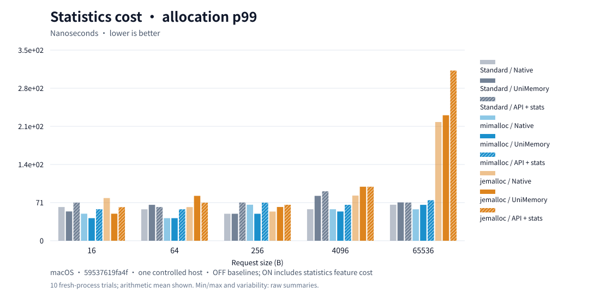

## 5 · Memory after release

**Memory across allocation, survival and release cycles.** The final phase has no live requests; retained resident memory may be cache, not a leak.

### Linux x64

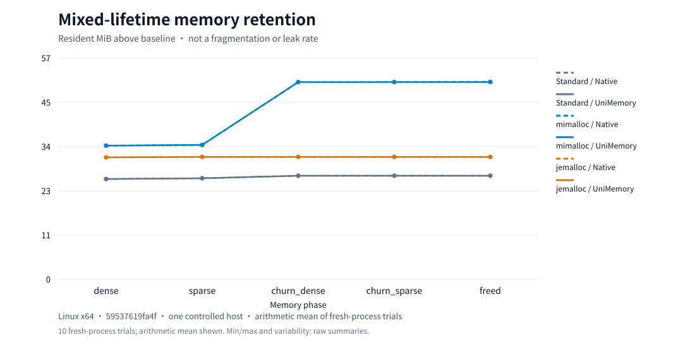

### Windows x64

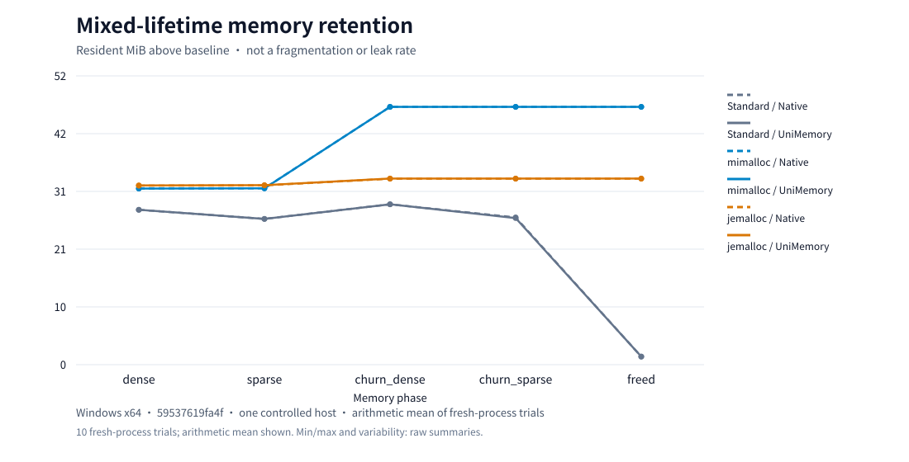

### macOS

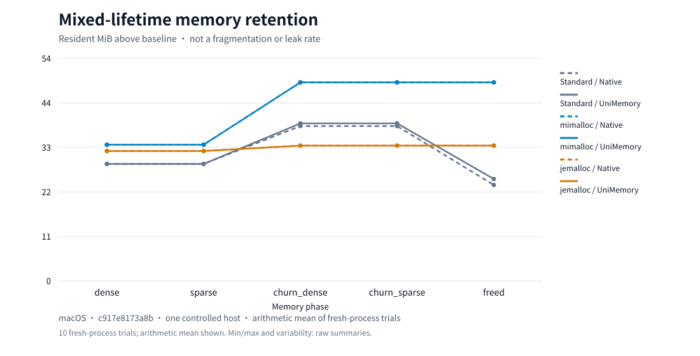

## 6 · Common operations

**Relative time for objects, resizing and containers; lower is better.** Standard equals 1 within each group; different operations have different costs.

### Linux x64

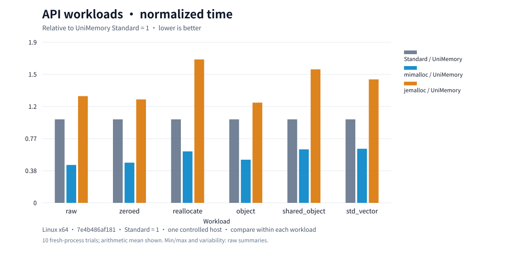

### Windows x64

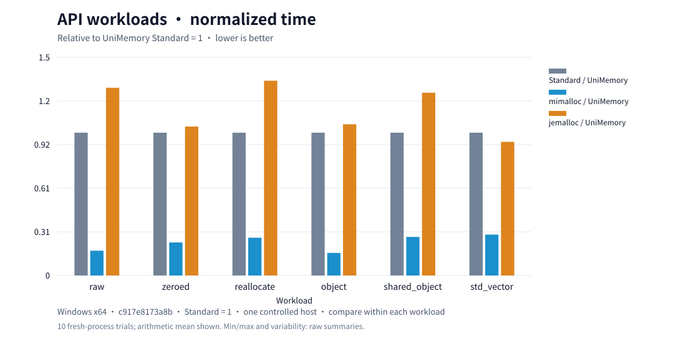

### macOS

## Common workloads

Standard = 1 within each workload; shorter bars are faster.

[Operation timings](performance/latency.md) · [Memory usage](performance/memory.md) · [Native applications](performance/applications.md)

## Data and method

[Measurements and environment](results/current/) · [Method](benchmarking.md)

Figures update with new measurements. Performance varies with hardware and workload.
