# 性能报告

[UniMemory](../README.zh-CN.md) · [English](performance.md) · **简体中文**

## 概览

三轮独立进程测量，取中位数。各后端、统计开关分别测量；只在同一负载内比较。

| 图例 | 含义 |
| --- | --- |
| 原生接口 | 直接调用分配器 |
| UniMemory 封装 | 关闭统计 |
| 封装＋统计 | 开启统计 |

## 1 · 吞吐量

**看线程增加后每秒能完成多少组分配/释放，越高越好。** 负载为 64 字节跨线程释放。

### Linux x64

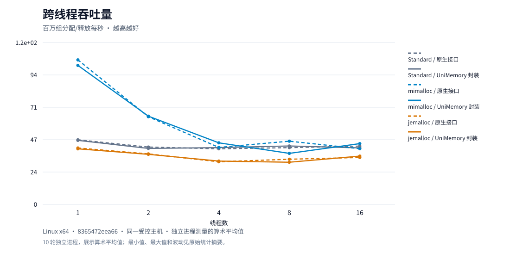

### Windows x64

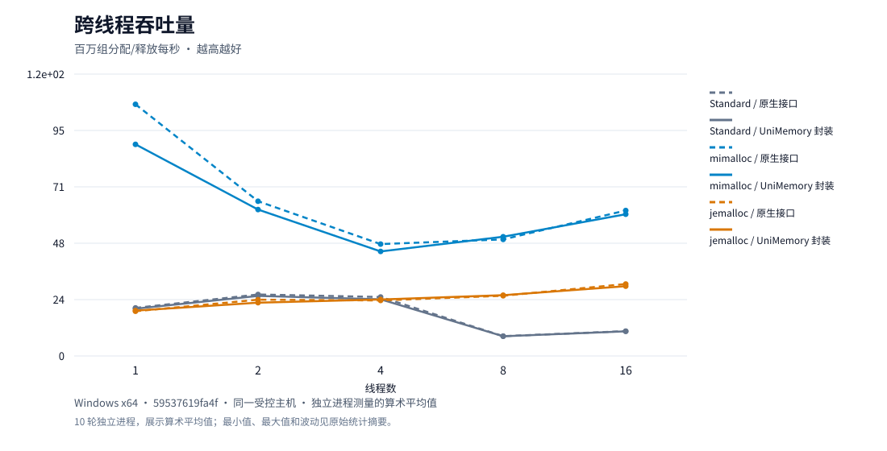

### macOS

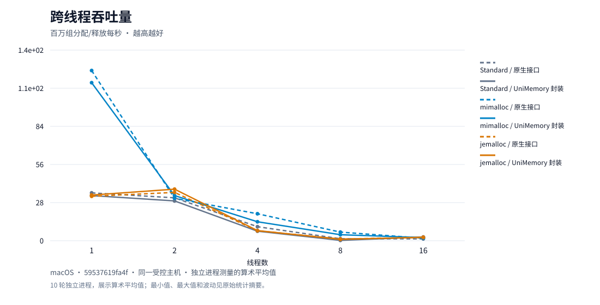

## 2 · 峰值内存

**看同一负载占用多少驻留内存，越低越好。** 包含线程栈、进程和分配器状态。

### Linux x64

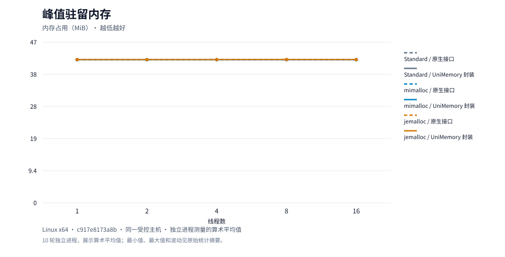

### Windows x64

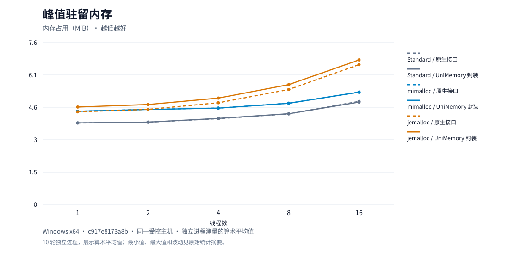

### macOS

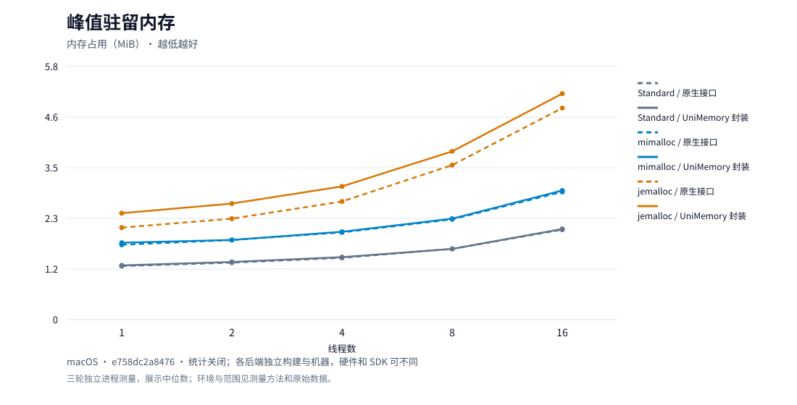

## 3 · 尾延迟

**看不同大小分配的慢请求，越低越好。** P99 表示 99% 的样本不超过该延迟，数值包含时钟开销。

### Linux x64

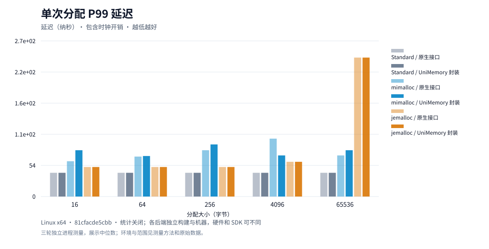

### Windows x64

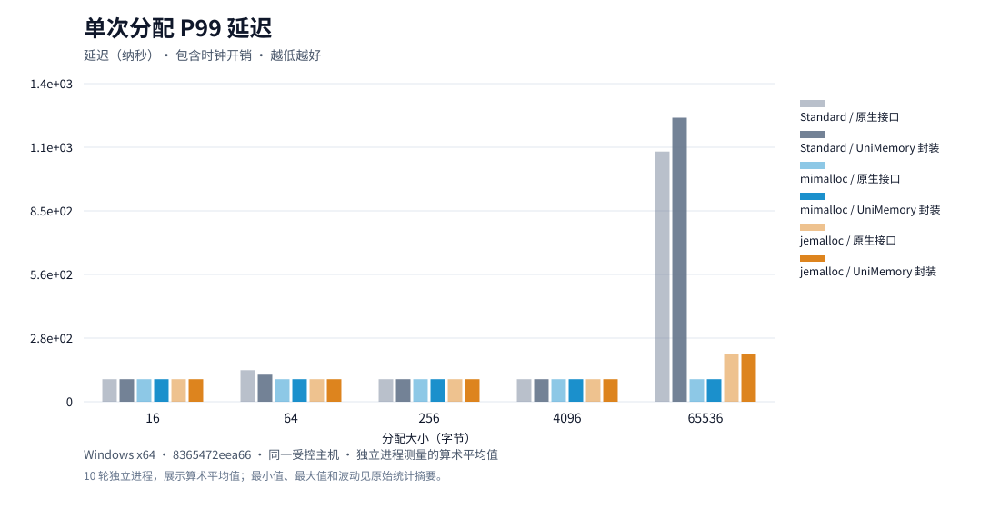

### macOS

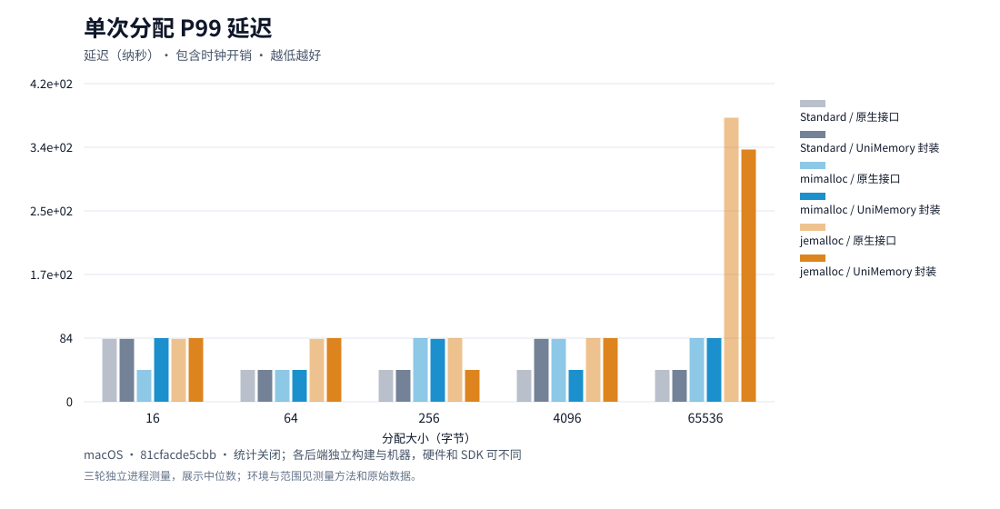

## 4 · 统计开销

**看统计开关下的分配延迟，越低越好。** 纹理柱表示开启统计；两种配置独立测量，不直接当作增量。

### Linux x64

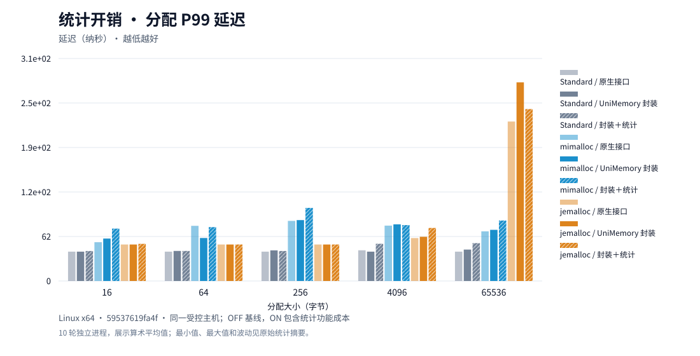

### Windows x64

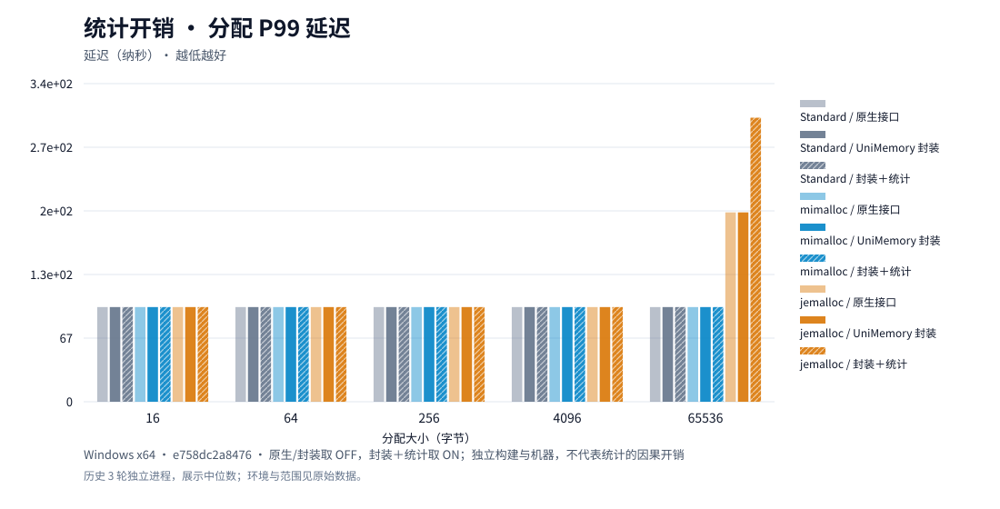

### macOS

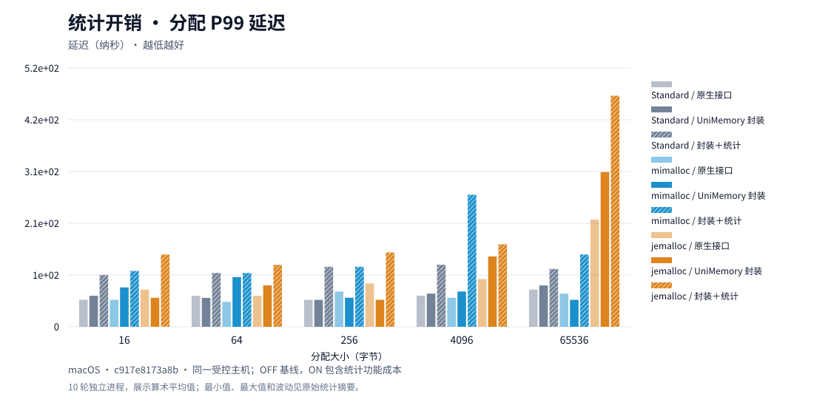

## 5 · 释放后内存

**看分配、保留、循环释放后的内存变化。** 最后阶段已无存活请求，剩余驻留内存可能是缓存，不等于泄漏。

### Linux x64

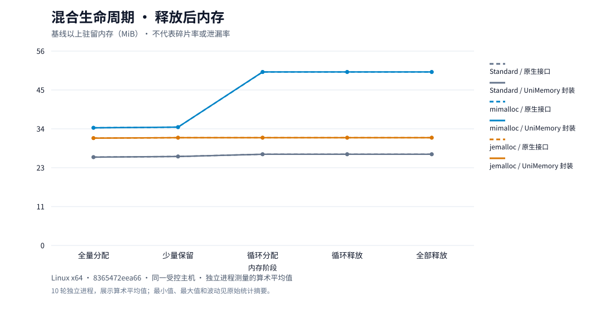

### Windows x64

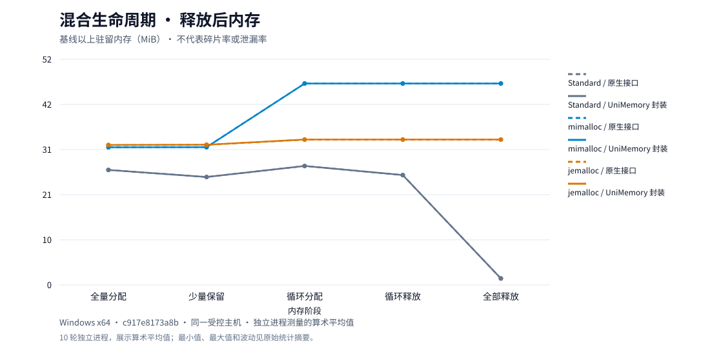

### macOS

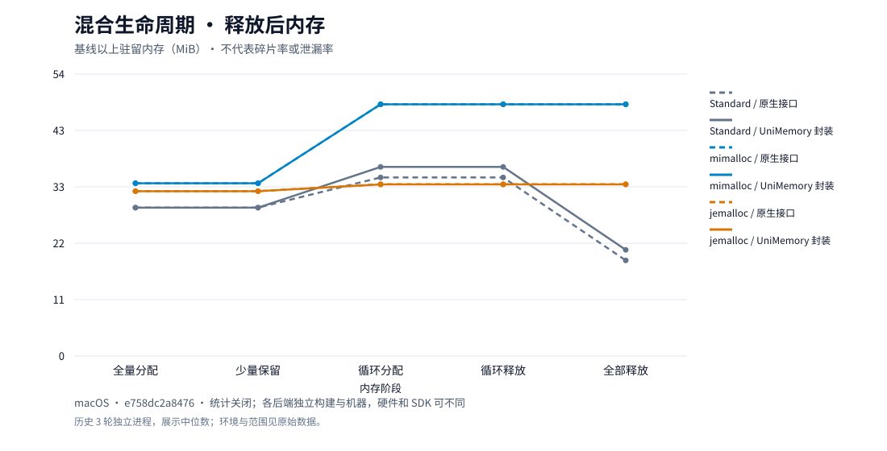

## 6 · 常用操作

**看对象、扩容和容器等操作的相对耗时，越低越好。** 同组 Standard 为 1；不同操作之间不比较绝对耗时。

### Linux x64

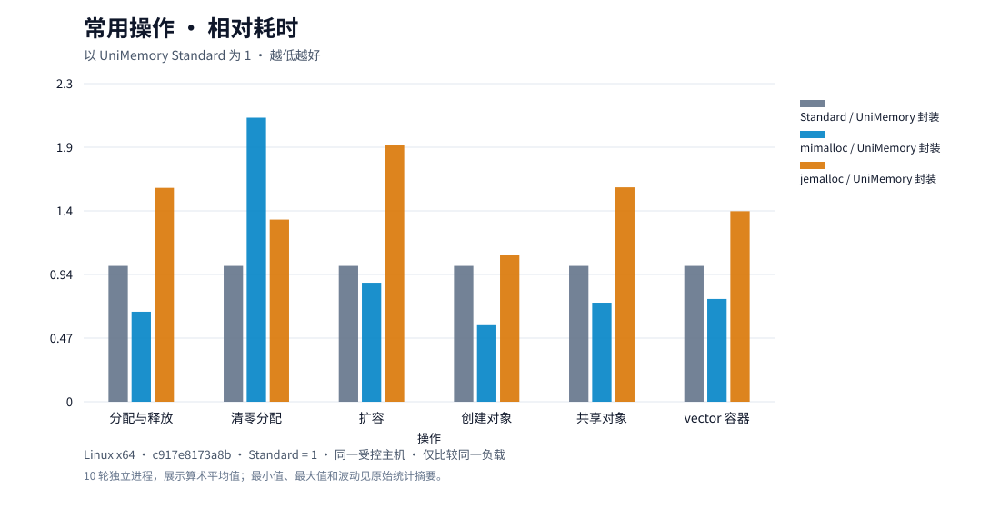

### Windows x64

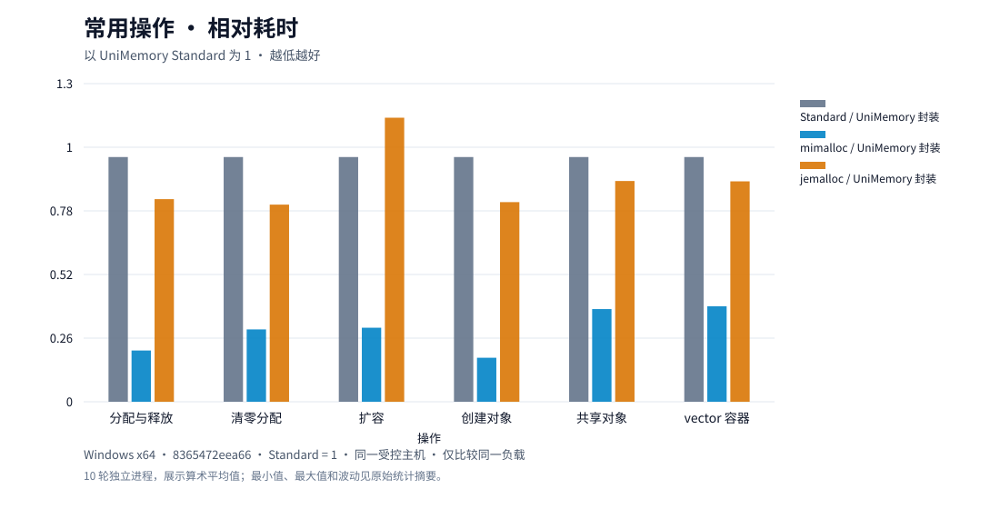

### macOS

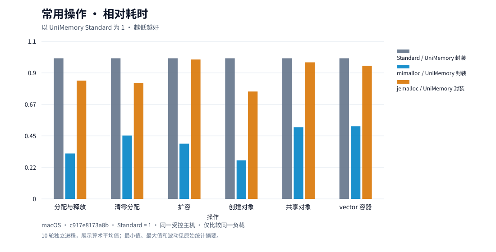

## 常用场景

同组 Standard = 1，条形越短越快。

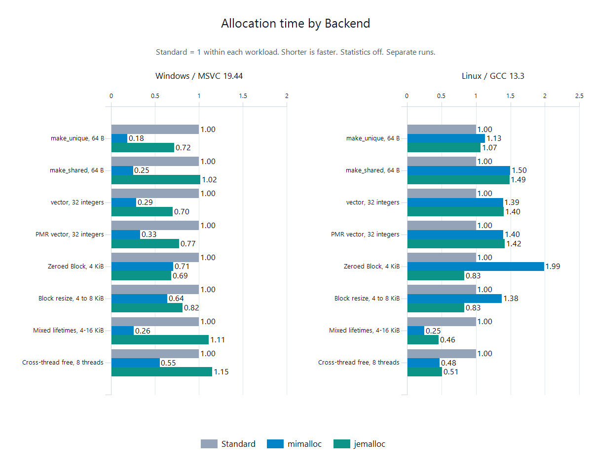

[操作耗时](performance/latency.zh-CN.md) · [内存占用](performance/memory.zh-CN.md) · [原生应用](performance/applications.zh-CN.md)

## 数据与方法

[实测数据与环境](results/current/) · [测量方法](benchmarking.zh-CN.md) · [优化对照](performance/header-only.zh-CN.md)

图表随新测量更新。实际表现取决于设备和使用场景。
