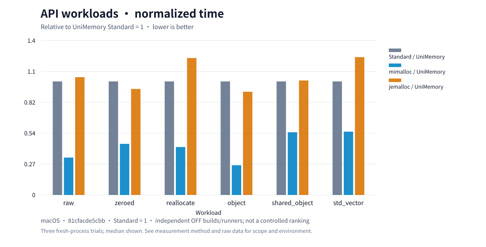

# Allocation time

[Performance](../performance.md) · **English** · [简体中文](latency.zh-CN.md)

**Nanoseconds per complete operation; lower is faster.** Global, counters off, Release builds. Trial count and aggregation are recorded below.

<!-- performance-source -->
2026-10-11 · [e758dc2](https://github.com/dugan-dev/UniMemory/actions/runs/38101997387) · [CSV](../results/current/README.md)
<!-- /performance-source -->

## Object, container and block

### Windows

<!-- performance-table:workloads-windows-x64 -->
| Workload | Standard | mimalloc | jemalloc |
| --- | --- | --- | --- |
| make_unique, 64 B | 43.6 | 8.1 | 31.4 |
| make_shared, 64 B | 49.9 | 12.4 | 50.7 |
| vector, 32 uint64_t | 611.7 | 174.6 | 428.7 |
| PMR vector, 32 uint64_t | 559.3 | 184.3 | 432.3 |
| Zeroed Block, 4 KiB | 88.1 | 62.4 | 60.4 |
| Block resize, 4 to 8 KiB | 162.9 | 104.5 | 132.8 |
| Mixed lifetimes, 4-16 KiB | 114.3 | 29.3 | 127.0 |
| Cross-thread free, 64 B, 8 threads | 92.2 | 51.0 | 106.2 |
<!-- /performance-table -->

### Linux

<!-- performance-table:workloads-linux-x64 -->
| Workload | Standard | mimalloc | jemalloc |
| --- | --- | --- | --- |
| make_unique, 64 B | 6.2 | 7.0 | 6.6 |
| make_shared, 64 B | 7.6 | 11.4 | 11.3 |
| vector, 32 uint64_t | 57.2 | 79.7 | 80.2 |
| PMR vector, 32 uint64_t | 62.1 | 86.6 | 88.2 |
| Zeroed Block, 4 KiB | 44.8 | 89.1 | 37.3 |
| Block resize, 4 to 8 KiB | 75.0 | 103.2 | 62.2 |
| Mixed lifetimes, 4-16 KiB | 102.6 | 26.1 | 47.4 |
| Cross-thread free, 64 B, 8 threads | 75.7 | 36.0 | 38.6 |
<!-- /performance-table -->

### macOS

<!-- performance-table:workloads-macos-arm64 -->
| Workload | Standard | mimalloc | jemalloc |
| --- | --- | --- | --- |
| make_unique, 64 B | 18.4 | 4.8 | 17.0 |
| make_shared, 64 B | 19.1 | 10.3 | 20.6 |
| vector, 32 uint64_t | 141.3 | 69.6 | 170.1 |
| PMR vector, 32 uint64_t | 144.5 | 88.7 | 185.5 |
| Zeroed Block, 4 KiB | 66.8 | 62.2 | 76.5 |
| Block resize, 4 to 8 KiB | 146.6 | 100.9 | 131.5 |
| Mixed lifetimes, 4-16 KiB | 31.6 | 21.5 | 23.7 |
| Cross-thread free, 64 B, 8 threads | 28.8 | 15.9 | 58.5 |
<!-- /performance-table -->

Objects include construction/destruction; vectors grow to 32 uint64_t values; resize includes allocation, growth and release. Compare within each row.

Standard = 1; shorter is faster. The macOS chart covers selected API scenarios; all eight workloads are in the tables.

## Native interface and counters

One allocation/free pair, alignment 16. Native calls the backend directly; API uses UniMemory with counters off; Basic enables counters. Native/API share the OFF build; Basic comes from the ON build.

### Windows

<!-- performance-table:latency-windows-x64 -->
| Bytes | Backend | Native | API | Basic |
| --- | --- | --- | --- | --- |
| 16 | Standard | 45.6 | 46.2 | 42.7 |
| 16 | mimalloc | 7.3 | 7.2 | 9.8 |
| 16 | jemalloc | 32.9 | 33.5 | 43.9 |
| 64 | Standard | 45.0 | 46.1 | 44.0 |
| 64 | mimalloc | 6.8 | 7.6 | 10.0 |
| 64 | jemalloc | 33.2 | 33.0 | 41.6 |
| 256 | Standard | 47.5 | 48.2 | 46.2 |
| 256 | mimalloc | 7.8 | 8.5 | 10.9 |
| 256 | jemalloc | 33.4 | 33.6 | 44.0 |
| 4096 | Standard | 47.5 | 49.0 | 44.7 |
| 4096 | mimalloc | 28.7 | 29.4 | 30.6 |
| 4096 | jemalloc | 35.9 | 36.5 | 46.9 |
| 65536 | Standard | 125.4 | 128.4 | 100.7 |
| 65536 | mimalloc | 31.5 | 32.2 | 33.4 |
| 65536 | jemalloc | 289.7 | 289.6 | 331.5 |
<!-- /performance-table -->

### Linux

<!-- performance-table:latency-linux-x64 -->
| Bytes | Backend | Native | API | Basic |
| --- | --- | --- | --- | --- |
| 16 | Standard | 8.7 | 8.8 | 26.2 |
| 16 | mimalloc | 8.4 | 9.4 | 10.4 |
| 16 | jemalloc | 11.3 | 11.3 | 16.3 |
| 64 | Standard | 8.5 | 9.0 | 25.9 |
| 64 | mimalloc | 8.8 | 9.5 | 10.3 |
| 64 | jemalloc | 10.3 | 10.9 | 16.5 |
| 256 | Standard | 8.8 | 9.4 | 25.8 |
| 256 | mimalloc | 9.8 | 10.2 | 10.9 |
| 256 | jemalloc | 10.4 | 10.8 | 16.7 |
| 4096 | Standard | 15.9 | 15.9 | 31.4 |
| 4096 | mimalloc | 24.1 | 24.4 | 24.6 |
| 4096 | jemalloc | 12.9 | 12.9 | 18.9 |
| 65536 | Standard | 17.3 | 17.4 | 31.7 |
| 65536 | mimalloc | 25.3 | 25.3 | 26.5 |
| 65536 | jemalloc | 193.5 | 192.4 | 253.2 |
<!-- /performance-table -->

### macOS

<!-- performance-table:latency-macos-arm64 -->
| Bytes | Backend | Native | API | Basic |
| --- | --- | --- | --- | --- |
| 16 | Standard | 16.5 | 18.9 | 19.8 |
| 16 | mimalloc | 5.0 | 5.3 | 6.7 |
| 16 | jemalloc | 15.2 | 16.7 | 18.1 |
| 64 | Standard | 19.6 | 20.8 | 24.2 |
| 64 | mimalloc | 5.2 | 5.7 | 6.9 |
| 64 | jemalloc | 16.0 | 21.3 | 18.7 |
| 256 | Standard | 19.5 | 20.7 | 20.2 |
| 256 | mimalloc | 6.8 | 6.8 | 7.9 |
| 256 | jemalloc | 16.1 | 15.6 | 23.3 |
| 4096 | Standard | 22.3 | 22.5 | 26.3 |
| 4096 | mimalloc | 14.7 | 15.3 | 20.1 |
| 4096 | jemalloc | 22.3 | 20.8 | 27.2 |
| 65536 | Standard | 27.4 | 25.4 | 26.5 |
| 65536 | mimalloc | 16.6 | 16.7 | 30.1 |
| 65536 | jemalloc | 248.3 | 262.3 | 297.3 |
<!-- /performance-table -->

Small differences may be measurement noise; counter cost varies by backend and size. Successful requests match in size and alignment.

## Cross-thread free

One thread allocates 64 B blocks; workers free them. Worker creation is outside timing; completion is inside.

<!-- performance-table:cross-thread -->
| Platform | Workers | Standard | mimalloc | jemalloc |
| --- | --- | --- | --- | --- |
| Windows | 2 | 63.7 | 30.2 | 80.2 |
| Windows | 4 | 84.8 | 34.9 | 92.0 |
| Windows | 8 | 92.2 | 51.0 | 106.2 |
| Linux | 2 | 65.6 | 22.6 | 21.8 |
| Linux | 4 | 81.8 | 23.7 | 29.1 |
| Linux | 8 | 75.7 | 36.0 | 38.6 |
| macOS | 2 | 26.2 | 14.2 | 49.9 |
| macOS | 4 | 26.1 | 14.4 | 45.4 |
| macOS | 8 | 28.8 | 15.9 | 58.5 |
<!-- /performance-table -->

## Stack

Prepared Buffer, one mark/allocate/rewind cycle, alignment 16. Writes one byte; its work differs from Heap allocation.

<!-- performance-table:stack -->
| Platform | Bytes | ns/cycle |
| --- | --- | --- |
| Windows | 64 | 3.39 |
| Windows | 4096 | 3.39 |
| Linux | 64 | 3.84 |
| Linux | 4096 | 3.83 |
| macOS | 64 | 4.33 |
| macOS | 4096 | 3.91 |
<!-- /performance-table -->

CPU affinity is unpinned. These are complete-operation medians; individual-allocation p95/p99 are on the performance overview.

[Method](../benchmarking.md) · [Raw data](../results/current/README.md) · [Memory](memory.md)
