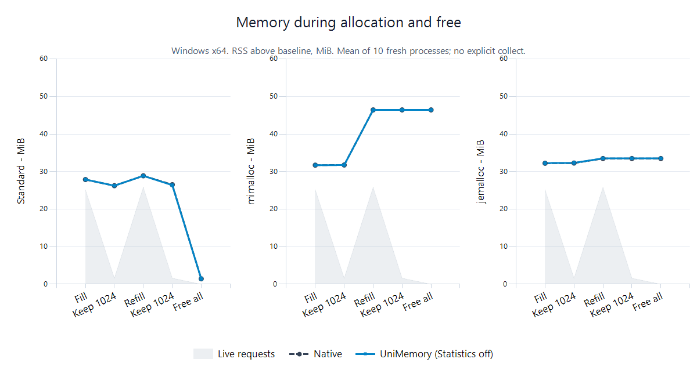

# Memory usage

[Performance](../performance.md) · **English** · [简体中文](memory.zh-CN.md)

**Resident process memory above baseline, MiB.** Subtract each process baseline before aggregation; counters off.

<!-- performance-source -->
2026-10-13 · [c917e81](https://github.com/dugan-dev/UniMemory/actions/runs/38415569101) · [CSV](../results/current/README.md)

10 fresh processes; mean [min, max], sample CV. All trials retained; sample SD and bootstrap 95% CI in raw summary.json.
<!-- /performance-source -->

Requested bytes are storage the application still needs. Resident memory also includes allocator caches and metadata. Freed storage can remain available for reuse.

## Mixed sizes and lifetimes

16384 Blocks, ten sizes from 17–8193 B, eight refill/free cycles; keep 1024 Blocks. All requested pages are touched.

Snapshots immediately follow operations, without an intentional wait or collection. Columns show initial fill, first survivors, final refill, final survivors and free all.

Live requested storage, MiB; the same workload runs on all platforms:

<!-- performance-table:pressure-requested -->
| Fill | Keep 1024 | Refill | Keep again | Free all |
| --- | --- | --- | --- | --- |
| 25.18 | 1.61 | 25.81 | 1.61 | 0.00 |
<!-- /performance-table -->

### Windows

<!-- performance-table:pressure-windows-x64 -->
| Backend | Path | Fill | Keep 1024 | Refill | Keep again | Free all |
| --- | --- | --- | --- | --- | --- | --- |
| Standard | Native | 26.51 [26.50, 26.52], CV 0.0% | 24.88 [24.87, 24.90], CV 0.0% | 27.42 [27.40, 27.45], CV 0.1% | 25.32 [25.23, 25.43], CV 0.3% | 1.49 [1.46, 1.53], CV 1.3% |
| Standard | UniMemory | 26.51 [26.50, 26.52], CV 0.0% | 24.88 [24.86, 24.91], CV 0.1% | 27.43 [27.40, 27.46], CV 0.1% | 25.33 [25.22, 25.43], CV 0.4% | 1.49 [1.48, 1.52], CV 0.9% |
| mimalloc | Native | 31.73 [31.73, 31.73], CV 0.0% | 31.77 [31.77, 31.77], CV 0.0% | 46.44 [46.44, 46.45], CV 0.0% | 46.44 [46.44, 46.45], CV 0.0% | 46.44 [46.44, 46.45], CV 0.0% |
| mimalloc | UniMemory | 31.72 [31.72, 31.73], CV 0.0% | 31.76 [31.76, 31.77], CV 0.0% | 46.44 [46.43, 46.44], CV 0.0% | 46.44 [46.43, 46.44], CV 0.0% | 46.44 [46.43, 46.44], CV 0.0% |
| jemalloc | Native | 32.24 [32.21, 32.27], CV 0.1% | 32.29 [32.26, 32.32], CV 0.1% | 33.49 [33.46, 33.51], CV 0.1% | 33.49 [33.46, 33.51], CV 0.1% | 33.49 [33.46, 33.51], CV 0.1% |
| jemalloc | UniMemory | 32.27 [32.24, 32.30], CV 0.1% | 32.32 [32.29, 32.35], CV 0.1% | 33.53 [33.50, 33.55], CV 0.1% | 33.53 [33.50, 33.55], CV 0.1% | 33.53 [33.50, 33.55], CV 0.1% |
<!-- /performance-table -->

### Linux

<!-- performance-table:pressure-linux-x64 -->
| Backend | Path | Fill | Keep 1024 | Refill | Keep again | Free all |
| --- | --- | --- | --- | --- | --- | --- |
| Standard | Native | 25.67 [25.67, 25.67], CV 0.0% | 25.86 [25.86, 25.86], CV 0.0% | 26.50 [26.50, 26.50], CV 0.0% | 26.50 [26.50, 26.50], CV 0.0% | 26.50 [26.50, 26.50], CV 0.0% |
| Standard | UniMemory | 25.67 [25.67, 25.67], CV 0.0% | 25.86 [25.86, 25.86], CV 0.0% | 26.50 [26.50, 26.50], CV 0.0% | 26.50 [26.50, 26.50], CV 0.0% | 26.50 [26.50, 26.50], CV 0.0% |
| mimalloc | Native | 34.20 [34.20, 34.20], CV 0.0% | 34.39 [34.39, 34.39], CV 0.0% | 50.39 [50.39, 50.39], CV 0.0% | 50.39 [50.39, 50.39], CV 0.0% | 50.39 [50.39, 50.39], CV 0.0% |
| mimalloc | UniMemory | 34.20 [34.20, 34.20], CV 0.0% | 34.39 [34.39, 34.39], CV 0.0% | 50.45 [50.39, 50.96], CV 0.4% | 50.50 [50.39, 50.96], CV 0.5% | 50.50 [50.39, 50.96], CV 0.5% |
| jemalloc | Native | 31.60 [31.20, 35.20], CV 4.0% | 31.72 [31.32, 35.32], CV 4.0% | 31.72 [31.32, 35.32], CV 4.0% | 31.72 [31.32, 35.32], CV 4.0% | 31.72 [31.32, 35.32], CV 4.0% |
| jemalloc | UniMemory | 31.40 [31.20, 33.20], CV 2.0% | 31.52 [31.32, 33.32], CV 2.0% | 31.52 [31.32, 33.32], CV 2.0% | 31.52 [31.32, 33.32], CV 2.0% | 31.52 [31.32, 33.32], CV 2.0% |
<!-- /performance-table -->

### macOS

<!-- performance-table:pressure-macos-arm64 -->
| Backend | Path | Fill | Keep 1024 | Refill | Keep again | Free all |
| --- | --- | --- | --- | --- | --- | --- |
| Standard | Native | 28.63 [28.62, 28.66], CV 0.0% | 28.63 [28.62, 28.66], CV 0.0% | 37.88 [34.45, 43.52], CV 11.8% | 37.88 [34.45, 43.52], CV 11.8% | 23.48 [18.45, 35.52], CV 29.5% |
| Standard | UniMemory | 28.62 [28.61, 28.66], CV 0.1% | 28.62 [28.61, 28.66], CV 0.1% | 38.55 [34.44, 43.50], CV 10.3% | 38.55 [34.44, 43.50], CV 10.3% | 24.95 [18.44, 35.50], CV 25.7% |
| mimalloc | Native | 33.32 [33.31, 33.33], CV 0.0% | 33.35 [33.33, 33.39], CV 0.1% | 48.58 [48.56, 48.62], CV 0.0% | 48.58 [48.56, 48.62], CV 0.0% | 48.58 [48.56, 48.62], CV 0.0% |
| mimalloc | UniMemory | 33.32 [33.31, 33.33], CV 0.0% | 33.33 [33.31, 33.38], CV 0.1% | 48.56 [48.55, 48.61], CV 0.0% | 48.56 [48.55, 48.61], CV 0.0% | 48.56 [48.55, 48.61], CV 0.0% |
| jemalloc | Native | 31.80 [31.78, 31.80], CV 0.0% | 31.81 [31.80, 31.81], CV 0.0% | 33.13 [33.12, 33.14], CV 0.0% | 33.13 [33.12, 33.14], CV 0.0% | 33.13 [33.12, 33.14], CV 0.0% |
| jemalloc | UniMemory | 31.78 [31.77, 31.78], CV 0.0% | 31.78 [31.77, 31.78], CV 0.0% | 33.10 [33.09, 33.11], CV 0.0% | 33.10 [33.09, 33.11], CV 0.0% | 33.10 [33.09, 33.11], CV 0.0% |
<!-- /performance-table -->

Charts connect phase snapshots, not continuous samples. Freed storage can remain resident; retention alone is not a leak or fragmentation rate.

## Size rounding

Extra usable capacity relative to requested bytes at initial fill. Standard has no portable capacity query. This excludes metadata and caches.

<!-- performance-table:rounding -->
| Platform | Backend | Path | Extra usable capacity |
| --- | --- | --- | --- |
| Windows | Standard | Native | — |
| Windows | Standard | UniMemory | — |
| Windows | mimalloc | Native | 25.04% [25.04, 25.04], CV 0.0% |
| Windows | mimalloc | UniMemory | 25.04% [25.04, 25.04], CV 0.0% |
| Windows | jemalloc | Native | 25.04% [25.04, 25.04], CV 0.0% |
| Windows | jemalloc | UniMemory | 25.04% [25.04, 25.04], CV 0.0% |
| Linux | Standard | Native | — |
| Linux | Standard | UniMemory | — |
| Linux | mimalloc | Native | 25.04% [25.04, 25.04], CV 0.0% |
| Linux | mimalloc | UniMemory | 25.04% [25.04, 25.04], CV 0.0% |
| Linux | jemalloc | Native | 25.04% [25.04, 25.04], CV 0.0% |
| Linux | jemalloc | UniMemory | 25.04% [25.04, 25.04], CV 0.0% |
| macOS | Standard | Native | — |
| macOS | Standard | UniMemory | — |
| macOS | mimalloc | Native | 25.04% [25.04, 25.04], CV 0.0% |
| macOS | mimalloc | UniMemory | 25.04% [25.04, 25.04], CV 0.0% |
| macOS | jemalloc | Native | 25.04% [25.04, 25.04], CV 0.0% |
| macOS | jemalloc | UniMemory | 25.04% [25.04, 25.04], CV 0.0% |
<!-- /performance-table -->

## Heap collect

16384 × 4096 B: 64 MiB, fully touched. Free each Block, then call collect() on independent Heap.

<!-- performance-table:footprint -->
| Platform | Backend | Kind | Live | Free | Collect |
| --- | --- | --- | --- | --- | --- |
| Windows | Standard | Global | 65.32 [65.32, 65.32], CV 0.0% | 0.97 [0.81, 1.07], CV 13.1% | — |
| Windows | Standard | Heap | 66.28 [66.27, 66.30], CV 0.0% | 0.52 [0.50, 0.53], CV 1.8% | 0.52 [0.50, 0.53], CV 1.8% |
| Windows | mimalloc | Global | 64.31 [64.31, 64.31], CV 0.0% | 64.32 [64.32, 64.32], CV 0.0% | — |
| Windows | mimalloc | Heap | 64.29 [64.29, 64.29], CV 0.0% | 64.29 [64.29, 64.29], CV 0.0% | 0.30 [0.30, 0.30], CV 0.0% |
| Windows | jemalloc | Global | 70.08 [70.05, 70.10], CV 0.0% | 70.08 [70.05, 70.11], CV 0.0% | — |
| Windows | jemalloc | Heap | 70.10 [70.07, 70.13], CV 0.0% | 70.10 [70.08, 70.13], CV 0.0% | 6.13 [6.11, 6.16], CV 0.3% |
| Linux | Standard | Global | 64.38 [64.38, 64.38], CV 0.0% | 0.25 [0.25, 0.25], CV 0.0% | — |
| Linux | Standard | Heap | 65.29 [65.29, 65.29], CV 0.0% | 65.29 [65.29, 65.29], CV 0.0% | 4.84 [4.84, 4.84], CV 0.0% |
| Linux | mimalloc | Global | 66.14 [66.14, 66.14], CV 0.0% | 66.14 [66.14, 66.14], CV 0.0% | — |
| Linux | mimalloc | Heap | 66.20 [66.13, 66.76], CV 0.3% | 66.20 [66.13, 66.76], CV 0.3% | 2.20 [2.13, 2.76], CV 9.1% |
| Linux | jemalloc | Global | 65.12 [65.12, 65.12], CV 0.0% | 65.12 [65.12, 65.12], CV 0.0% | — |
| Linux | jemalloc | Heap | 67.53 [67.12, 71.12], CV 1.9% | 67.53 [67.12, 71.12], CV 1.9% | 3.65 [3.25, 7.25], CV 34.7% |
| macOS | Standard | Global | 64.28 [64.28, 64.28], CV 0.0% | 9.08 [8.28, 16.28], CV 27.9% | — |
| macOS | Standard | Heap | 65.47 [65.47, 65.50], CV 0.0% | 10.28 [9.47, 17.50], CV 24.7% | 10.28 [9.47, 17.50], CV 24.7% |
| macOS | mimalloc | Global | 64.34 [64.33, 64.34], CV 0.0% | 64.34 [64.33, 64.34], CV 0.0% | — |
| macOS | mimalloc | Heap | 64.31 [64.30, 64.31], CV 0.0% | 64.31 [64.30, 64.31], CV 0.0% | 64.31 [64.30, 64.31], CV 0.0% |
| macOS | jemalloc | Global | 65.53 [65.53, 65.55], CV 0.0% | 65.53 [65.53, 65.55], CV 0.0% | — |
| macOS | jemalloc | Heap | 65.54 [65.53, 65.55], CV 0.0% | 65.54 [65.53, 65.55], CV 0.0% | 1.54 [1.53, 1.55], CV 0.5% |
<!-- /performance-table -->

collect() reclaims eligible idle resources; it does not destroy live objects or guarantee an immediate memory decrease.

## Library storage

<!-- performance-table:storage -->
| Platform | Memory / B | OwnedBlock / B | `Allocator<T>` / B |
| --- | --- | --- | --- |
| Windows | 48 | 32 | 8 |
| Linux | 48 | 32 | 8 |
| macOS | 48 | 32 | 8 |
<!-- /performance-table -->

Type sizes come from the measured builds. They exclude Global shared state, Basic counters and native metadata. Stack setup requires no separate state allocation.

Linux uses smaps_rollup RSS, Windows uses the working set, and macOS uses resident size. OS peak counters differ from phase snapshots.

[Method](../benchmarking.md) · [Raw data](../results/current/README.md) · [Native programs](applications.md)
